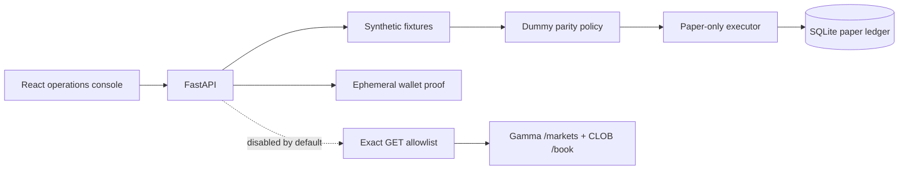

# Prediction Market Ops Lab

An independent, safety-first reference implementation inspired by lessons from a private Polymarket
side project built with friends.

This repository demonstrates the operational side of a prediction-market integration: public
Gamma/CLOB reads, ephemeral wallet proof, deterministic paper automation, idempotent state, a typed
dashboard, health checks, diagnostics, CI, containers, and a release runbook. It makes no claim about
profitability and contains no strategy intended to trade.

> **Safety invariant:** live execution is absent. There is no order submission, cancellation, token
> approval, bridge, deposit, withdrawal, transfer, production wallet, or authenticated trading client.

## See it locally

With Docker Desktop running:

```bash
docker compose up --build -d
```

- Dashboard: `http://127.0.0.1:5173`
- OpenAPI: `http://127.0.0.1:8000/docs`
- Health: `http://127.0.0.1:8000/healthz`
- Readiness: `http://127.0.0.1:8000/readyz`
- Diagnostics: `http://127.0.0.1:8000/api/diagnostics`
- Metrics: `http://127.0.0.1:8000/metrics`

Run a deterministic cycle from the dashboard. It creates a synthetic paper intent with a fixed size,
passes through the hard execution boundary, and records one idempotent SQLite row.

## Architecture



The default path is fully synthetic and works without credentials. Optional public reads are enabled
with `OPS_LAB_PUBLIC_READS=1`; the client still permits only two exact public `GET` routes. See the
[architecture](docs/ARCHITECTURE.md) for boundaries and failure behavior.

## Safety controls

- API callers cannot supply an execution mode.
- `PaperExecutor` rejects every value except exact `paper` before invoking persistence.
- SQLite repeats the invariant with `CHECK (mode = 'paper')`.
- The outbound adapter verifies HTTPS, exact hostname, exact path, and `GET`.
- The project has no secret configuration and no trading SDK.
- Wallet proof creates a temporary local account and returns only its public address and verification
  result; the key and signature never enter the response or ledger.
- Default fixtures, prices, identifiers, fills, and screenshots are synthetic.

## Verification

Backend:

```bash
python -m venv .venv
.venv/Scripts/python -m pip install -e ".[dev]"
.venv/Scripts/python -m ruff check backend scripts
.venv/Scripts/python -m pytest backend/tests
.venv/Scripts/python scripts/scan_public_tree.py
```

Dashboard:

```bash
cd dashboard
npm ci
npm test
npm run typecheck
npm run build
```

CI executes both suites, scans tracked files, validates Compose, and builds both non-root images. It
does not push images or deploy.

## Repository map

```text
backend/ops_lab/       FastAPI, boundaries, public read adapter, wallet proof, paper ledger
backend/tests/         Contract, failure, idempotency, integration, and API tests
dashboard/src/         Typed industrial operations console
scripts/               Public-tree credential and sensitive-file scan
docs/ARCHITECTURE.md   Components, trust boundaries, data flow, deployment model
docs/RUNBOOK.md        Start, health, failure drill, diagnosis, release checklist
docs/CASE_STUDY.md     Contribution context, decisions, evidence, portfolio narrative
docs/PROVENANCE.md     Public sources and dependency rationale
docs/THREAT_MODEL.md   Assets, threats, controls, deliberately absent capabilities
```

## Local development

Start the API:

```bash
.venv/Scripts/uvicorn ops_lab.app:create_app --factory --reload
```

Start the dashboard in another terminal:

```bash
cd dashboard
npm run dev
```

The Vite server proxies local API routes. For diagnosis and failure drills, use the
[operations runbook](docs/RUNBOOK.md).

## Scope and provenance

This is a new implementation based on public documentation and original synthetic requirements. It
does not reuse private code, Git history, strategies, schemas, configurations, screenshots, logs,
wallets, user data, infrastructure details, or financial metrics. See [provenance](docs/PROVENANCE.md)
and the [case study](docs/CASE_STUDY.md).

Licensed under the [MIT License](LICENSE).
