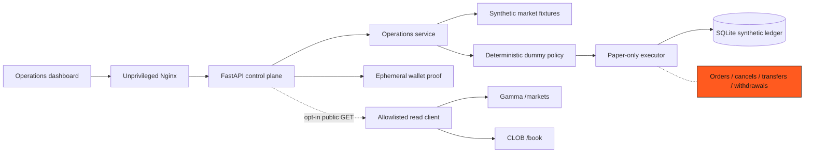

# Architecture

## System view

The dashed optional path is disabled by default. The solid path is a complete offline demonstration
using synthetic identifiers and prices. `Blocked` is not a dormant feature: those clients, endpoints,
credentials, models, and signing flows do not exist in the repository.

## Boundaries

| Boundary | Input | Output | Failure behavior |
|---|---|---|---|
| Dashboard to API | Typed JSON over local HTTP | Operational read models | Visible degraded state |
| API to synthetic provider | In-process fixtures | Three deterministic snapshots | Readiness becomes `503` |
| Policy to executor | `PaperIntent` | Simulated result | Any mode other than exact `paper` raises before persistence |
| Executor to ledger | Synthetic paper intent | Idempotent fill | SQLite transaction rolls back |
| Wallet proof | Local challenge | Public address + boolean | Empty challenges rejected |
| Public read adapter | Exact HTTPS GET route | Validated public schema | Timeout/retry/fail-closed |

## Public Polymarket integration

The outbound adapter allows only these pairs:

- `GET https://gamma-api.polymarket.com/markets`
- `GET https://clob.polymarket.com/book`

The check covers scheme, hostname, and exact path. Redirects, authenticated order routes, arbitrary
Gamma routes, mutating methods, and lookalike hosts are rejected before network I/O. Timeouts are five
seconds. Network failures and `5xx` responses receive two bounded retries; `4xx` responses do not.
Responses are parsed into strict Pydantic models before reaching the service layer.

## Execution invariant

The execution boundary is deliberately narrow:

1. The API accepts only a synthetic `market_id`; callers cannot choose an execution mode.
2. The dummy policy constructs `mode="paper"`, fixed size `1.00`, and an outcome based on sequence parity.
3. `PaperExecutor` compares the mode to the exact string `paper` before invoking the ledger.
4. SQLite repeats the invariant with `CHECK (mode = 'paper')`.
5. There is no authenticated CLOB SDK or write-capable transport in the dependency graph.

## Deployment model

Compose builds two non-root images. The dashboard proxy is the local entry point and forwards API
paths to the backend. The backend filesystem is read-only except for a named `/data` volume and `/tmp`.
Both services expose container health checks. CI verifies backend and frontend code independently,
scans tracked files, validates Compose, and builds both images without publishing them.
